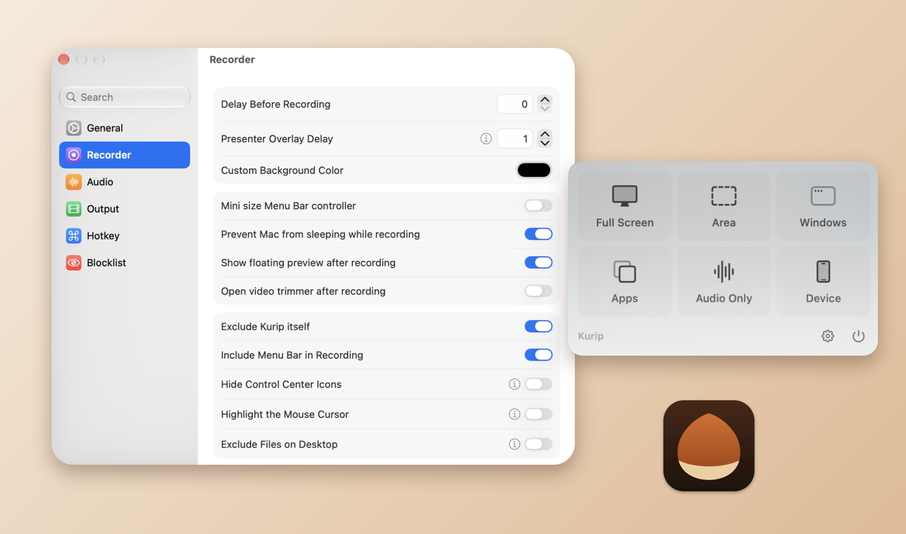

<h1 align="center">Kurip 🌰</h1>
<h3 align="center">A lightweight screen recorder for modern macOS <a href="./README_zh.md">[中文]</a> <a href="./README_ja.md">[日本語]</a>

Kurip (栗 *kuri* + clip) is a fork of [QuickRecorder](https://github.com/lihaoyun6/QuickRecorder) by [@lihaoyun6](https://github.com/lihaoyun6), maintained for the latest macOS releases.

## Screenshot

<picture>
  <source media="(prefers-color-scheme: dark)" srcset="./img/preview_en_dark.png">
  <source media="(prefers-color-scheme: light)" srcset="./img/preview_en.png">
  
</picture>

## What's different from QuickRecorder
- **Native menu bar controls**: Stop / Pause / Resume / Camera Overlay are a standard macOS menu, so they work again on macOS 26 and later (the old in-menu-bar buttons stopped receiving clicks).
- The menu bar panel closes automatically after you pick a recording mode.
- Kurip registers itself in **Privacy & Security → Screen & System Audio Recording** properly, so it shows up in the list.
- Settings from an existing QuickRecorder install (save folder, shortcuts, etc.) are imported on first launch.

## Installation
### Requirements
- macOS 12.3 or later (tested on macOS 27)

### Build from source
1. Clone this repository and open `QuickRecorder.xcodeproj` in Xcode.
2. In *Signing & Capabilities*, choose your own team.
3. Build and run the `QuickRecorder` scheme. The app is produced as `Kurip.app`.
4. On first launch, allow Kurip in **System Settings → Privacy & Security → Screen & System Audio Recording**.

## Features
- Record screens, screen areas, windows, applications, mobile devices and system audio.
- Driver-free audio loopback recording, mouse highlighting, screen magnifier and more.
- Full support for macOS 14 **[Presenter Overlay](https://support.apple.com/guide/facetime/presenter-overlay-video-conferencing-fctm6333f4bd/mac)** *(macOS 12/13 can use the floating camera window)*.
- `HEVC with Alpha` output that keeps the alpha channel *(supported by iMovie and Final Cut Pro)*.

## Q&A
**1. Where can I reopen the main panel after closing it?**
> Click Kurip's Dock icon or menu bar icon.

**2. Why is Kurip not a sandboxed app?**
> It is not distributed through the App Store, so it does not need to be sandboxed.

**3. How do I edit system audio and microphone volume separately?**
> Turn off `Record Microphone to Main Track` in Settings. System audio and microphone are then saved as two separate audio tracks.

## Acknowledgements
Kurip is built on **[QuickRecorder](https://github.com/lihaoyun6/QuickRecorder)** by **[@lihaoyun6](https://github.com/lihaoyun6)**. Huge thanks for creating such a great app and releasing it as open source. The full commit history of the original project is preserved in this repository.

Projects QuickRecorder itself builds on:
- [Azayaka](https://github.com/Mnpn/Azayaka) @Mnpn: inspiration and part of the screen recording engine
- [KeyboardShortcuts](https://github.com/sindresorhus/KeyboardShortcuts) @sindresorhus: global shortcuts
- [SwiftLAME](https://github.com/hidden-spectrum/SwiftLAME) @Hidden Spectrum: MP3 output
- [Sparkle](https://github.com/sparkle-project/Sparkle): app updates

## License
[AGPL-3.0](./LICENSE), the same as the original QuickRecorder. Original work © 2024 lihaoyun6; modifications © 2026 inoxixi7.
