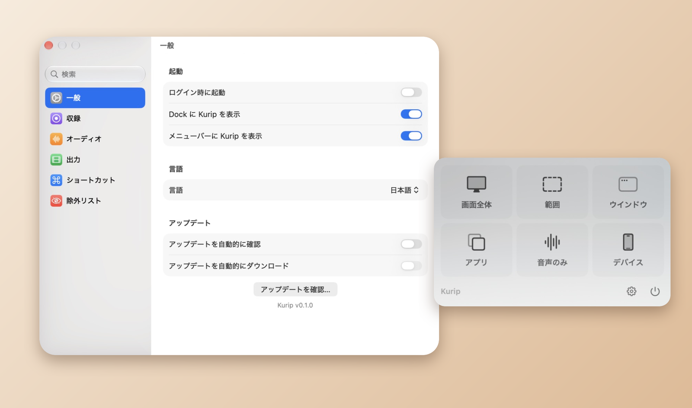

<p align="center">

<h1 align="center">Kurip 🌰</h1>
<h3 align="center">最新の macOS のための軽量な画面収録アプリ<br><a href="./README.md">[English]</a> <a href="./README_zh.md">[中文]</a></h3>
</p>

Kurip（栗 *kuri* + clip）はメニューバーに常駐し、数クリックで画面全体・ウィンドウ・アプリ・画面の一部、または音声だけを収録できます。[@lihaoyun6](https://github.com/lihaoyun6) さんの [QuickRecorder](https://github.com/lihaoyun6/QuickRecorder) をもとに、macOS 26 以降に合わせてデザインを作り直しました。

<p align="center">

</p>

## 主な機能
- **何でも収録**：画面全体、画面の一部、ウインドウ、アプリ、iPhone / iPad、システム音声のみ。
- **メニューバーのパネルひとつで操作**：モードを選び、表示されるバーでオプションを設定して、赤いボタンを押すだけ。
- **音声**：ドライバ不要でアプリの音とマイクを収録。エコーキャンセルに対応し、編集用に別トラックへ分けることもできます。
- **収録中**：一時停止 / 再開、現在のフレームを保存、カメラオーバーレイ、画面拡大鏡、カーソルのハイライト。メニューバーからも、自分で決めたショートカットからも操作できます。
- **収録後**：右下のカードから「Finder に表示」「トリミング」「共有」をすぐに実行できます。
- **出力**：H.264 / HEVC、HDR、透明度を保持する `HEVC with Alpha`（iMovie と Final Cut Pro が対応）。
- **システム設定スタイルの設定画面**（検索つき）。
- **多言語対応**：English、简体中文、繁體中文、日本語、Deutsch、Italiano。設定から切り替えられます。

## QuickRecorder からの主な変更点
- macOS 26 以降で再び使えるようになりました。メニューバーの操作は標準の macOS メニューになり、「画面とシステムオーディオの収録」の一覧にも正しく表示されます。
- メインパネル、収録バー、オプションバーをデザインし直し、ボタンのスタイルを統一しました。
- 「音声のみ」の収録は専用のポップオーバーから開始できます。終了時には確認が表示されます。
- 収録を開始できないときは、強制終了せずに理由を表示します。
- 日本語とドイツ語の翻訳を追加し、イタリア語を補完しました。
- 初回起動時に、インストール済みの QuickRecorder の設定を引き継ぎます。

## インストール
**動作環境**：macOS 12.3 以降。macOS 27 で開発・動作確認しています。

1. [Releases](https://github.com/inoxixi7/Kurip/releases) から最新の `Kurip-x.y.z.zip` をダウンロードして展開し、`Kurip.app` を「アプリケーション」フォルダに移動します。
2. Kurip は Apple の公証を受けていないため、初回の起動はブロックされます。**システム設定 → プライバシーとセキュリティ**を開き、下の方にある Kurip のメッセージの横の**このまま開く**をクリックし、パスワードで確認してください。
   または、ターミナルで一度だけ次を実行します：
   ```bash
   xattr -dr com.apple.quarantine /Applications/Kurip.app
   ```
3. 確認が表示されたら、**システム設定 → プライバシーとセキュリティ → 画面とシステムオーディオの収録**で Kurip を許可します。

アップデートは「設定 → 一般」の「アップデートを確認…」から行えます。自動確認もそこでオンにできます。

### ソースからビルド
1. このリポジトリをクローンし、Xcode で `Kurip.xcodeproj` を開きます。
2. *Signing & Capabilities* で自分の開発チームを選択します。
3. `Kurip` スキームをビルドして実行します。

## よくある質問
**メインパネルはどこから開きますか？**
> メニューバーの Kurip アイコンをクリックします（設定で Dock アイコンを表示している場合は Dock からも開けます）。

**なぜサンドボックスアプリではないのですか？**
> App Store では配布しないため、サンドボックス化の必要がありません。

**システム音声とマイクの音量を編集時に別々に調整するには？**
> 「設定 → オーディオ」で「マイクをメイントラックに録音」をオフにすると、システム音声とマイクが別々のトラックに保存されます。

**ウインドウを収録すると紫色の「共有中」マークが映り込むのはなぜですか？**
> macOS がウインドウの画面収録時に自動で描画するもので、アプリ側からは隠せません。

## Claude Code による開発
Kurip のデザインの刷新、新しい翻訳、各種の修正、そしてこの README は、Anthropic の AI コーディングエージェント [Claude Code](https://claude.com/claude-code) と一緒に作りました。メンテナーの指示のもとで Claude Code がコードを書き、実際に動いているアプリで一つずつ動作を確認しています。

## 謝辞
Kurip は **[@lihaoyun6](https://github.com/lihaoyun6)** さんの **[QuickRecorder](https://github.com/lihaoyun6/QuickRecorder)** をもとに開発しています。素晴らしいアプリを作り、オープンソースとして公開してくださったことに心から感謝します。このリポジトリには元プロジェクトのコミット履歴をすべて残しています。

QuickRecorder が利用・参考にしているプロジェクト：
- [Azayaka](https://github.com/Mnpn/Azayaka) @Mnpn：着想元および収録エンジンの一部
- [KeyboardShortcuts](https://github.com/sindresorhus/KeyboardShortcuts) @sindresorhus：グローバルショートカット
- [SwiftLAME](https://github.com/hidden-spectrum/SwiftLAME) @Hidden Spectrum：MP3 出力
- [Sparkle](https://github.com/sparkle-project/Sparkle)：アップデート機能

## ライセンス
元の QuickRecorder と同じく [AGPL-3.0](./LICENSE) です。原著作物 © 2024 lihaoyun6、変更部分 © 2026 inoxixi7。
