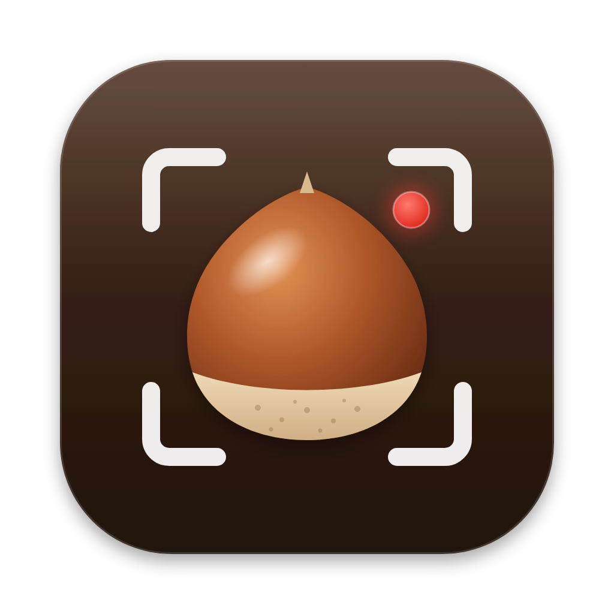
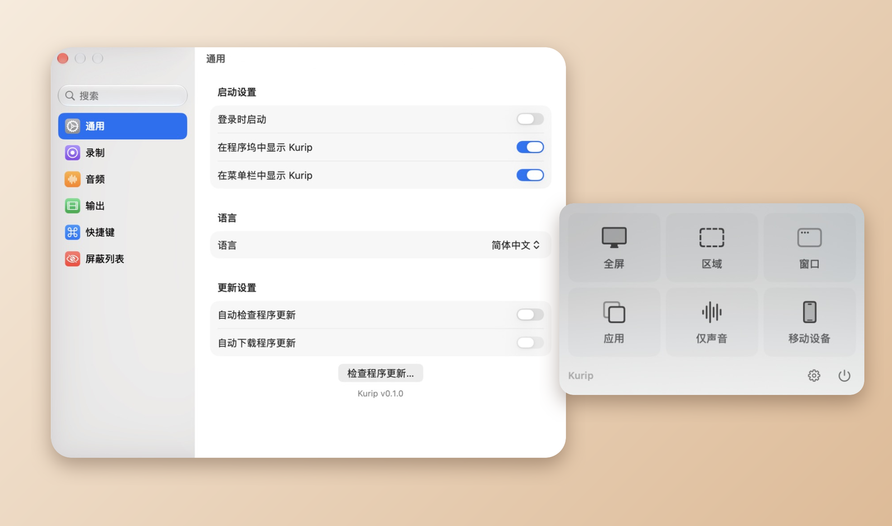

<p align="center">

<h1 align="center">Kurip 🌰</h1>
<h3 align="center">面向新版 macOS 的轻量化录屏工具<br><a href="./README.md">[English]</a> <a href="./README_ja.md">[日本語]</a></h3>
</p>

Kurip（栗 *kuri* + clip）常驻在菜单栏里，点几下就能录制整个屏幕、窗口、App、屏幕区域，或者只录声音。它基于 [@lihaoyun6](https://github.com/lihaoyun6) 的 [QuickRecorder](https://github.com/lihaoyun6/QuickRecorder) 修改而来，并针对 macOS 26 及以后的系统重新设计了界面。

<p align="center">

</p>

## 功能
- **想录什么都行**：全屏、屏幕区域、窗口、App、iPhone / iPad，或者只录系统声音。
- **菜单栏一个面板搞定**：选好模式，在弹出的工具条里设置选项，按下红色按钮即可开始。
- **声音**：无需额外驱动即可录制 App 声音和麦克风，支持回声消除，也可以分成两条音轨方便后期调整。
- **录制中**：暂停 / 继续、保存当前帧截图、摄像头浮窗、屏幕放大镜、鼠标高亮，都能在菜单栏或用自定义快捷键操作。
- **录制后**：右下角弹出卡片，可直接「在访达中显示」「修剪视频」「共享」。
- **输出**：H.264 / HEVC、HDR，以及保留透明通道的 `HEVC with Alpha`（iMovie 与 Final Cut Pro 支持）。
- **系统设置风格的设置窗口**，支持搜索。
- **多语言**：English、简体中文、繁體中文、日本語、Deutsch、Italiano，可在设置中切换。

## 与 QuickRecorder 的区别
- 在 macOS 26 及以后的系统上恢复可用：菜单栏控制改为标准的 macOS 菜单，并能正确出现在「录屏与系统录音」权限列表中。
- 重新设计了主面板、录制工具条和选项栏，按钮风格统一。
- 「仅声音」录制有了独立的气泡面板；退出前会先确认。
- 录制无法开始时会说明原因，而不是直接闪退。
- 新增日语和德语翻译，补全了意大利语。
- 首次启动时自动导入已安装的 QuickRecorder 的设置。

## 安装
**系统要求**：macOS 12.3 及以上，在 macOS 27 上开发和测试。

1. 从 [Releases](https://github.com/inoxixi7/Kurip/releases) 下载最新的 `Kurip-x.y.z.zip`，解压后把 `Kurip.app` 拖进「应用程序」文件夹。
2. Kurip 没有经过 Apple 公证，第一次打开会被系统拦下。请打开**系统设置 → 隐私与安全性**，在页面下方 Kurip 的提示旁点击**仍要打开**，再输入密码确认。
   也可以在终端里运行一次：
   ```bash
   xattr -dr com.apple.quarantine /Applications/Kurip.app
   ```
3. 系统询问时，在**系统设置 → 隐私与安全性 → 录屏与系统录音**中允许 Kurip。

之后可以在「设置 → 通用」中点击「检查程序更新…」，也可以在那里开启自动检查。

### 从源码编译
1. 克隆本仓库，用 Xcode 打开 `Kurip.xcodeproj`。
2. 在 *Signing & Capabilities* 中选择你自己的开发者团队。
3. 编译并运行 `Kurip` scheme。

## 常见问题
**主面板在哪里打开？**
> 点击菜单栏里的 Kurip 图标（如果在设置中开启了程序坞图标，也可以点程序坞）。

**为什么 Kurip 不是沙盒 App？**
> Kurip 不通过 App Store 分发，因此不需要做成沙盒 App。

**如何在后期分别调整系统声音和麦克风的音量？**
> 在「设置 → 音频」中关闭「将麦克风录制到主音轨」，系统声音和麦克风就会分别保存为两条音轨。

**为什么录制窗口时画面里有一个紫色的「正在共享」标记？**
> 这是 macOS 在录制窗口时自己画上去的，App 无法隐藏。

## 使用 Claude Code 开发
Kurip 的界面重设计、新增翻译、各项修复以及这份 README，都是与 Anthropic 的 AI 编程助手 [Claude Code](https://claude.com/claude-code) 一起完成的：在维护者的指导下，由 Claude Code 编写代码，并在实际运行的 App 中逐项测试。

## 致谢
Kurip 基于 **[@lihaoyun6](https://github.com/lihaoyun6)** 的 **[QuickRecorder](https://github.com/lihaoyun6/QuickRecorder)** 开发。非常感谢原作者打造了这么好用的录屏工具并将其开源。本仓库完整保留了原项目的提交历史。

QuickRecorder 本身使用或参考了以下项目：
- [Azayaka](https://github.com/Mnpn/Azayaka) @Mnpn：灵感来源及部分录屏引擎代码
- [KeyboardShortcuts](https://github.com/sindresorhus/KeyboardShortcuts) @sindresorhus：全局快捷键
- [SwiftLAME](https://github.com/hidden-spectrum/SwiftLAME) @Hidden Spectrum：MP3 输出
- [Sparkle](https://github.com/sparkle-project/Sparkle)：应用更新

## 许可证
[AGPL-3.0](./LICENSE)，与原版 QuickRecorder 相同。原作品 © 2024 lihaoyun6；修改部分 © 2026 inoxixi7。
